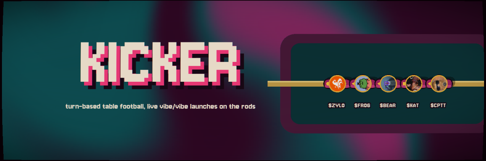
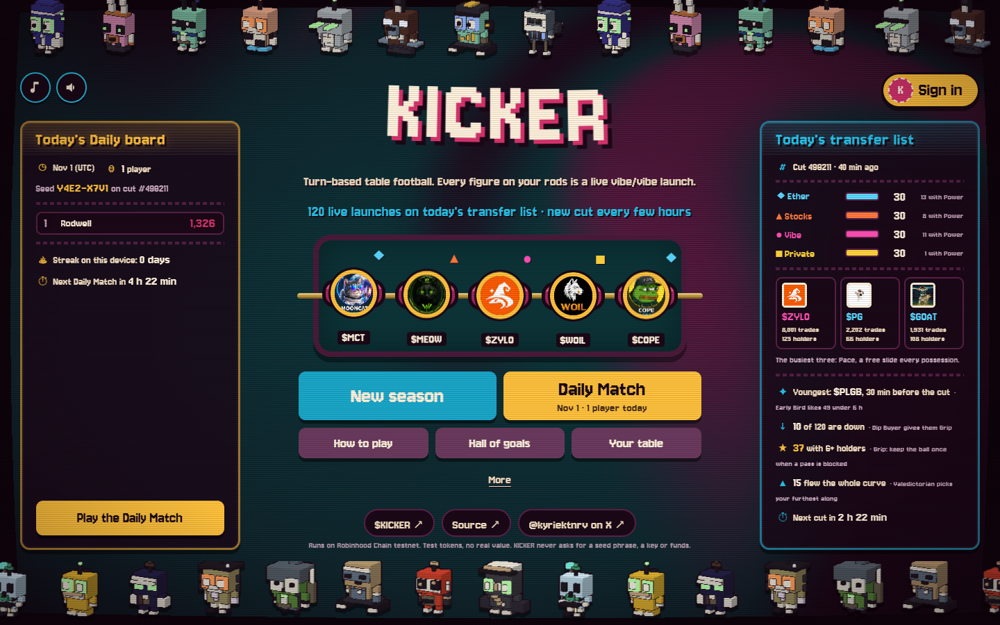
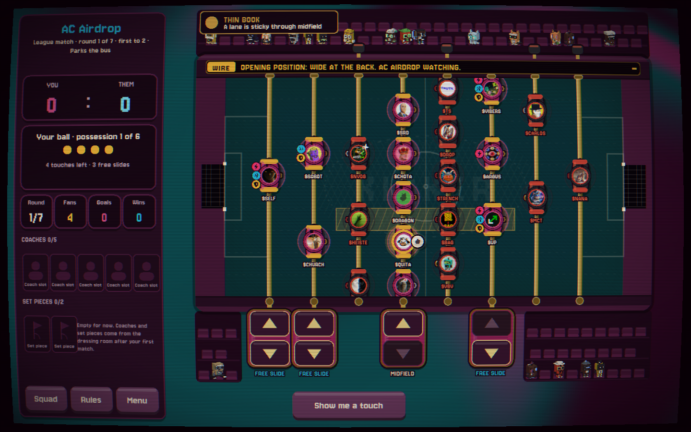
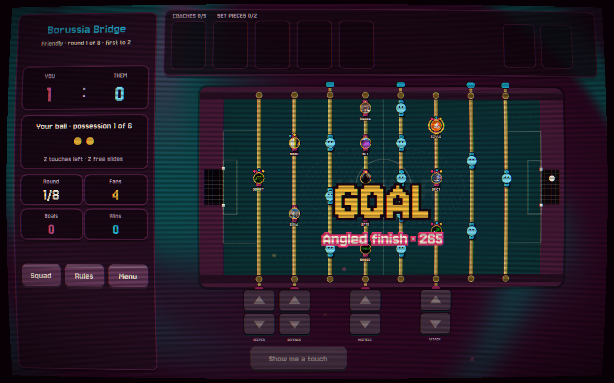
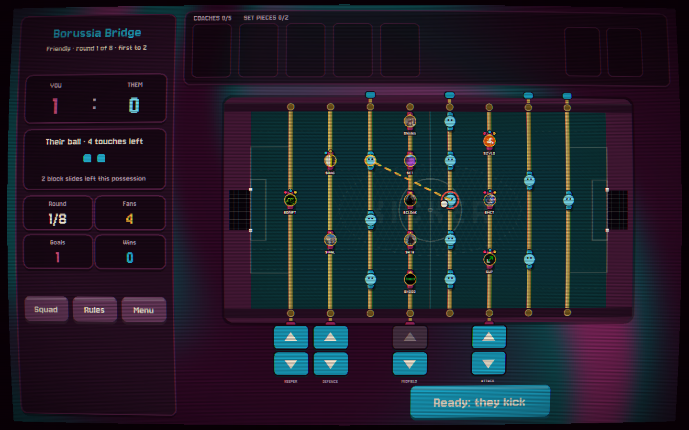
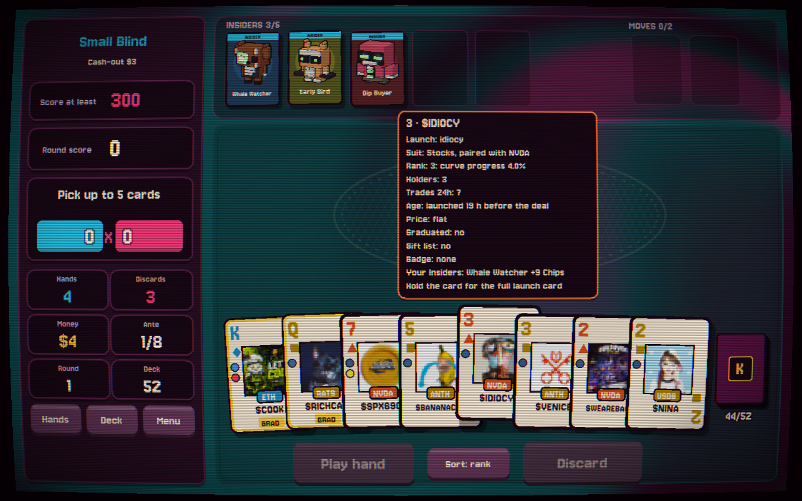
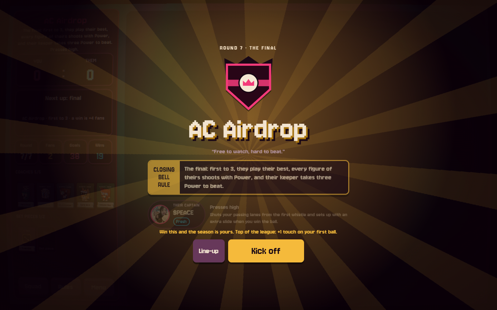
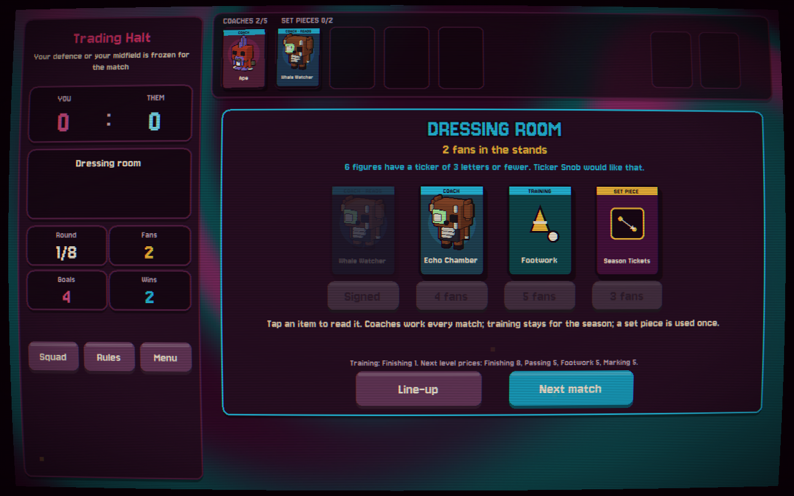
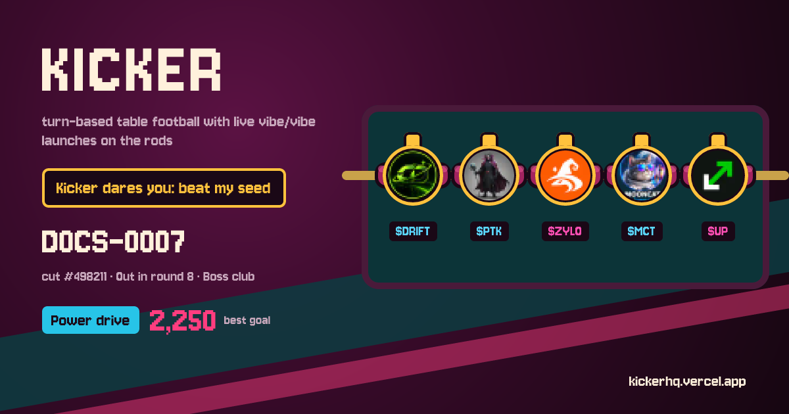

<p align="center">
  
</p>

<h3 align="center">Turn-based table football where every figure on your rods is a live vibe/vibe launch.</h3>

<p align="center">
  <a href="https://kickerhq.vercel.app"><b>Play now → kickerhq.vercel.app</b></a>
  &nbsp;·&nbsp; <a href="https://testnet.vibevibe.fun/token/0x0e76e43c28E1094dD0912c33BFf34004E110c323">$KICKER on vibe/vibe</a>
  &nbsp;·&nbsp; <a href="https://x.com/kyriektnrv">@kyriektnrv on X</a>
  &nbsp;·&nbsp; Robinhood Chain testnet &nbsp;·&nbsp; PixiJS + WebGL
</p>

---

## What it is

Kicker is what the Germans call table football. KICKER is a turn-based table football season played from above: four rods a side, a ball, touches instead of a clock, and a rival club that reacts to every one of them.

Your eleven figures are launches from [vibe/vibe](https://testnet.vibevibe.fun), the token launchpad on Robinhood Chain testnet. Each figure wears its token's picture as a head and its ticker underneath, and its numbers decide how it plays.

<p align="center">
  
  
</p>

## How a match plays

- **The table.** Keeper (1 figure), defence (2), midfield (5) and attack (3), interleaved like a real table. Ten lanes across; the goal mouth is the middle two. A rod slides one lane at a time and its figures move together.
- **Your ball.** Four touches a possession. A touch is a **slide** of one rod, or a **kick** with the figure on the ball: a pass to a figure further up, or a shot. The ball runs straight or one lane sideways per rod it crosses, and comes back off the side walls. Any of their figures in its lane blocks it and wins the ball.
- **They react.** After every touch the rival slides to cover your most dangerous lane, and sets its defence before your first touch. It gets sharper by the round: it starts shutting passing lanes, slides twice a touch, reads your blocks, and finally shoots through a blocker.
- **Their ball.** They show the lanes they can kick down (red for shots, amber for passes). You get two block slides a possession; slide into the lanes, then press **Ready**.
- **Full time.** First to 2 goals (the final: 3), six possessions each. A friendly or a league match can end level and you go through without the win fans; a boss club has to be beaten.

Nothing is rolled at play time. The squad, the rival clubs and the shelf come from the seed; every move the rival makes comes from the position on the table.

<p align="center">
  
  
</p>

## How a launch becomes a figure

| Stat | Comes from | What it does |
|---|---|---|
| **Power** | curve progress, 10% or more | an attacker's shot goes through one blocker |
| **Pace** | 10+ trades in the last 24h | a free slide for that figure's rod, every possession |
| **Grip** | 6+ holders | when its pass is blocked, it keeps the ball, once a possession |
| **Pair** | what the launch is quoted in: Ether, a stock, VIBEVIBE, or a private token or dollar | a stripe on the shoulders; some coaches read it |
| **Head** | the token's own picture | |

Your squad is drawn by the seed from today's cut and placed by its numbers: the three furthest along their curve up front, the most-held in goal and at the back. Swap anyone in the **Line-up** before a match.

Hover a figure (or hold it on a phone) for its data tag: holders, 24h trades, age at the cut, price direction, curve progress, gift list, and which number or coach gives it each stat. Keep holding for its page on vibe/vibe.

<p align="center">
  
</p>

## The season

Eight rounds. Each round is a **friendly**, a **league match** and a **boss club**. Ten boss clubs change one rule each:

- **The Rug**: your defence rod is pulled off the table.
- **Trading Halt**: your defence or midfield is frozen.
- **Vibe Check**: only figures with Power, Pace or Grip may shoot.
- **The Depeg**: your shots drift one lane as they travel.
- **Gas Spike**: each slide costs two touches.
- **Mempool Jam**: passes land a turn late; they react before the ball arrives.
- **Max Slippage**: one touch fewer every possession.
- **Lockup**: your keeper is locked.
- **Wash Trade**: the rod facing yours copies every slide you make.
- **Closing Bell**, the final: first to 3, the rival at full strength, and their keeper takes three Power to beat.

<p align="center">
  
  
</p>

## The dressing room

Wins and goals bring **fans**: 2, 3 or 4 for a friendly, a league match or a boss club, plus one a goal. Fans are only good for the dressing room, and every price is printed. The shelf is fixed by your seed.

- **Coaches** (31, five seats). Passive tactics, most of them reading the launches on your rods: ETH Maxi gives your Ether-paired figures Power, Dip Buyer gives Grip to figures whose price is down, Early Bird gives Pace to launches under six hours old, Moonboy lowers the Power bar, Valedictorian makes your launch furthest along its curve shoot through two blockers. Hover one to light the figures it works on.
- **Training**. Finishing, Passing, Footwork and Marking, levelled for the season.
- **Set pieces**. One use each: Free Kick, One-Two, Dummy Run, Long Ball, Park the Bus, Season Tickets.

## Goals, the Hall and challenges

Every goal is rated: more for each pass in the move, for an angle, off a wall, for each blocker beaten with Power, from distance and with touches to spare, and more in later rounds and against a boss. A season's best goal is its score.

A season is fixed by its **seed and cut number**. Share the seed and a friend plays the same squad against the same clubs. When a season ends, KICKER makes a **challenge link**: the server plays every touch again, checks it, and draws an image for X of the figures behind your best goal. A forged, reordered or unfinished trail is refused.

Verified seasons with a name go into the **Hall of goals**: the day's top 50 best goals (UTC).

<p align="center">
  
</p>

## Daily Match

One seed a day, the same for everybody, on the first cut after 00:00 UTC. Post it with a name and it lands on the **Daily board**: one line per name, your best of the day counts. Finish it on consecutive days and your device keeps a streak.

## Sign in

Optional. Sign in with email, Google, X, Discord or a wallet, through [Para](https://getpara.com). Browser wallets are offered inside Para's modal; KICKER's own code never calls a wallet, so there is no `window.ethereum` and no EIP-6963 on the page. If you have no wallet, Para makes one for you. It starts with no `$KICKER`.

Para is a lazily loaded React island: it is fetched only when you open sign-in, or hover, focus or touch the button. The rest of the page is Preact and doesn't carry it.

Once a day you sign one plain text message (no gas, no transaction, nothing moves). It claims your Hall of goals name (a ✓ next to it, and nobody else posts under it), keeps **Your table** (Daily streak, best goal of each day, last 30 seasons) on any device, and checks `$KICKER` for team kits.

**Privacy.** Para runs the sign-in and holds your login, plus the wallet it creates for you. KICKER stores no emails or passwords. If you never sign in, your seasons and settings stay in this browser, and the one thing sent anywhere is a season you choose to post, under the name you give it. Signed in, KICKER also keeps the name you claimed, your address and the seasons you post. KICKER has no use for your seed phrase, a private key or funds, and will not ask.

## Team kits

Hold any `$KICKER` on Robinhood Chain testnet and your side can change shirts: **Closing Bell**, **Ticker Tape** and **Pink Sheets**, each with its own felt, and a small house mark next to your name in the Hall of goals and on share images. The server reads your `balanceOf` once with the day's sign-in. Without it nothing is missing: every match plays the same.

## The token

[`$KICKER`](https://testnet.vibevibe.fun/token/0x0e76e43c28E1094dD0912c33BFf34004E110c323) is the game's own launch on vibe/vibe, on Robinhood Chain testnet: a test token with no real value. It is **cosmetic only**. It never changes a figure, a rival or a result. The engine doesn't know the token exists.

## Under the hood

- **Client:** PixiJS v8 (WebGL), TypeScript, Vite, Preact overlays, custom shaders for the swirling background and the CRT pass, WebAudio-synthesised sound, a table that stands upright on phones, `prefers-reduced-motion` respected.
- **Engine:** one pure state machine in `shared/`, run by the page and by the server. The rival is a deterministic evaluator: it scores your threats lane by lane and slides to cover the worst. `shared/bot.ts` is a two-touch-deep player used for balance runs, tests and the "Show me a touch" button.
- **Sign-in:** Para (`@getpara/react-sdk`) in a lazily loaded React island, with its own wagmi connectors for browser wallets. The chain is Robinhood Chain testnet (46630), defined with viem `defineChain`.
- **Server:** Vercel Functions for the squad cut every few hours (farm bots and dead tokens filtered), the daily pin and board, token pictures, season verification, sign-in (viem signature checks, ERC-1271 for smart accounts, name claims, Your table), team kits (one `balanceOf` read), and challenge images (satori + resvg). Responses sit behind the CDN, and nothing polls.
- **Data:** the public vibe/vibe v6 index on Robinhood Chain testnet (chain id 46630).

```bash
npm install
npm run dev     # local dev server
npm run build   # type-check client and api, then build
npm test        # engine, rival, boss clubs, replay guard, daily pin and board, team kits, sign-in, names (in memory)
npm test -- --anvil   # also checks a real ERC-1271 account on a local anvil (port 8520)
npx tsx scripts/sim.ts 300   # the bot plays 300 seasons and reports how far it gets
```

Sign-in needs a Para API key at build time: `VITE_PARA_API_KEY`, and `VITE_PARA_ENV=PRODUCTION` for a production key (Para's test environment otherwise). Without a key the sign-in button says it is unavailable, and everything else plays the same.

## Notes

News and updates: [@kyriektnrv on X](https://x.com/kyriektnrv).

Testnet only. Fans, goals and ratings are a game: they are not money and don't stand for anything you own. KICKER is an independent project built on public vibe/vibe data, and it is not made by the vibe/vibe team.

## License

MIT
