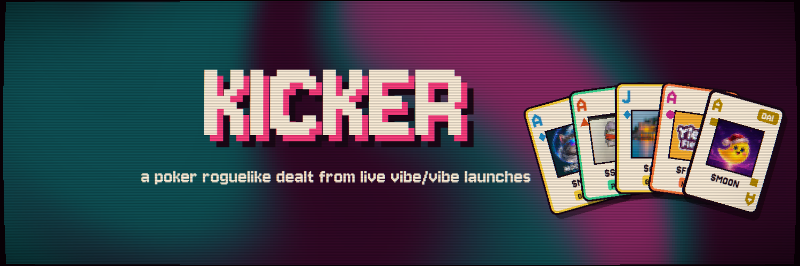
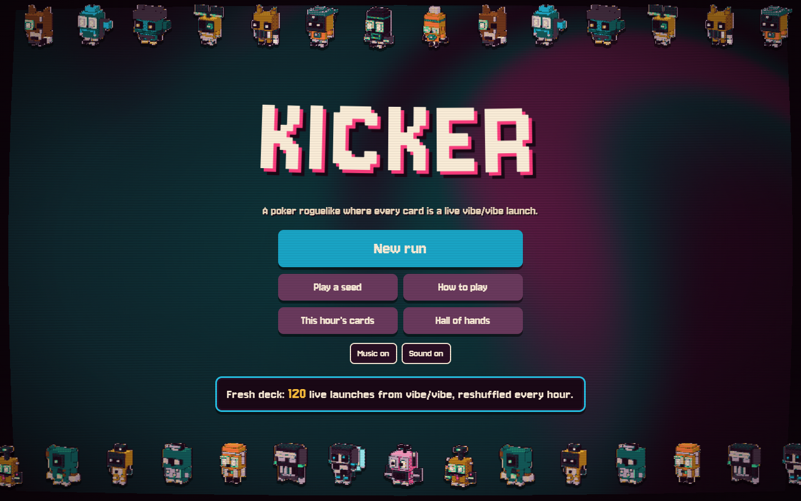
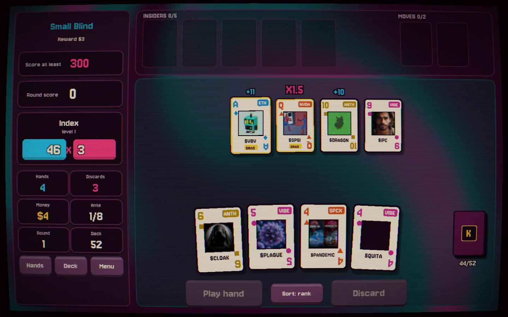
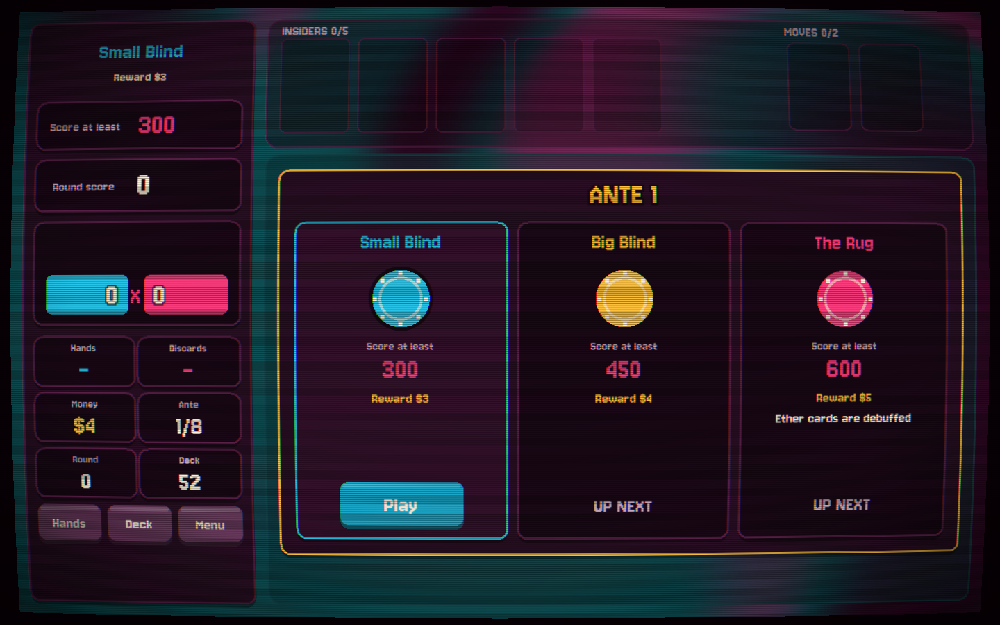
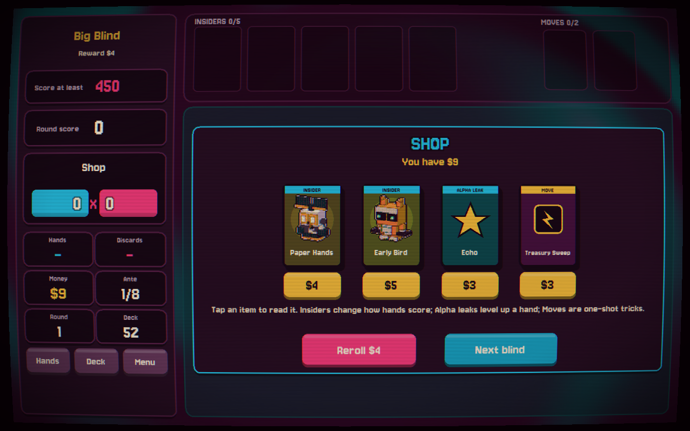

<p align="center">
  
</p>

<h3 align="center">A poker roguelike where every card is a live vibe/vibe launch.</h3>

<p align="center">
  <a href="https://kickerhq.vercel.app"><b>Play now → kickerhq.vercel.app</b></a>
  &nbsp;·&nbsp; <a href="https://testnet.vibevibe.fun/token/0x0e76e43c28E1094dD0912c33BFf34004E110c323">$KICKER on vibe/vibe</a>
  &nbsp;·&nbsp; Robinhood Chain testnet &nbsp;·&nbsp; PixiJS + WebGL
</p>

---

## What it is

KICKER deals you a 52-card deck cut from the newest launches on [vibe/vibe](https://testnet.vibevibe.fun), the token launchpad on Robinhood Chain testnet. Every card is a real token: its picture, its ticker, and its stats come straight from the live index when the deck is cut.

You build poker-style hands out of those launches, beat the blind, spend your winnings in the shop, and try to survive eight antes and the Closing Bell.

<p align="center">
  
  
</p>

## How a launch becomes a card

| Card part | Comes from |
|---|---|
| **Suit** | what the launch is paired with: **Ether** (ETH), **Stocks** (NVDA, AAPL, SPCX), **Vibe** (VIBEVIBE), **Private** (OPENAI, ANTHROPIC, USDG) |
| **Rank** | its place inside the suit by bonding-curve progress: the Ace is the launch closest to graduation, the 2 is the one furthest behind |
| **Badges** | `GRAD` graduated · `HOT` 40+ trades in 24h · `PUMP` / `DIP` price moved ±15% |
| **Picture** | the token's own image |

A new deck is cut every hour. Farm bots and dead tokens are filtered out before the cut, so the deck stays playable.

Long-press a card in your hand, or open it from the deck view, to see the launch behind it: picture, pair, curve progress, price change, trades, holders and badges, with a link to its page on vibe/vibe.

## Hands

Eleven hands of its own: **Solo Bag**, **Echo**, **Double Echo**, **Index**, **Pile-in**, **Curve Run**, **Quote Flush**, **Full Book**, **Ticker Flush**, **Stampede** and **Graduation Run**. Every hand scores **Chips × Mult**, and **Alpha leaks** level hands up during a run.

## Blinds and bosses

Each ante is a Small Blind, a Big Blind and a boss. Ten bosses bend the rules: **The Rug**, **Trading Halt**, **Vibe Check**, **The Depeg**, **Gas Spike**, **Mempool Jam**, **Max Slippage**, **Lockup**, **Wash Trade**, and the final **Closing Bell**.

<p align="center">
  
  
</p>

## The shop

- **Insiders** (31). Jokers that read the launches you hold: holders, trades, curve progress, age, even ticker length. Diamond Hands, Paper Hands, Dip Buyer, Whale Watcher, Sniper Bot, Ticker Snob, Valedictorian and more.
- **Alpha leaks**. Level up a hand.
- **Moves**. One-shot plays like Burn, Clone, Bridge to Stocks or Treasury Sweep.

## Challenge a friend

A run is fully defined by its **seed and deck number**. Share the seed and your friend plays the exact same deal.

When a run ends, KICKER makes a **challenge link**. The server replays every move of the run, checks the score, and renders a card for X showing the five cards of your best hand. A forged move list is rejected.

## Hall of hands

Verified runs with a name go into the **Hall of hands**, the day's top 50 best hands across all players (UTC). Only runs the server has replayed move by move can get in.

## Under the hood

- **Client:** PixiJS v8 (WebGL), TypeScript, Vite, Preact overlays, custom shaders for the swirling background and the CRT pass, WebAudio-synthesised sound, touch and portrait layout, `prefers-reduced-motion` respected.
- **Server:** Vercel Functions for the hourly deck cut, token pictures, run verification and challenge cards (satori + resvg). Responses sit behind the CDN, and nothing polls.
- **Data:** the public vibe/vibe v6 index on Robinhood Chain testnet (chain id 46630).

```bash
npm install
npm run dev     # local dev server
npm run build   # type-check client and api, then build
```

## Notes

Testnet only. Cards, chips and scores are a game: they are not money and don't stand for anything you own. KICKER is an independent project built on public vibe/vibe data, and it is not made by the vibe/vibe team.

## License

MIT
