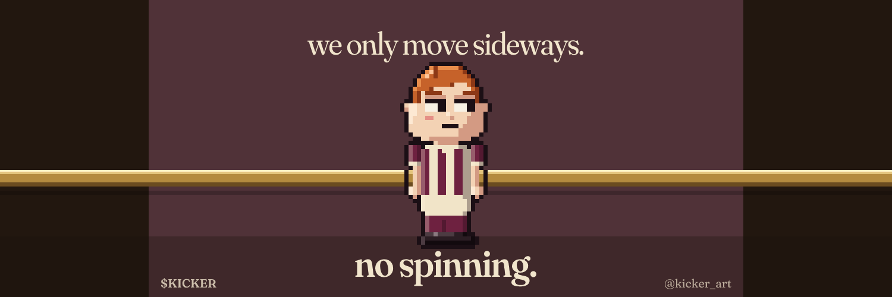

<p align="center">
  
</p>

# KICKER

a meme. a wooden football man bolted through the chest to a brass rod. he only moves sideways. no spinning.

[kickerhq.vercel.app](https://kickerhq.vercel.app) · [$KICKER on vibe/vibe](https://testnet.vibevibe.fun/token/0x7e1be1573fD7Fe434a53Abb38356AcfFDF15c1C4) · [@kicker_art](https://x.com/kicker_art)

## what's there

- **the memes.** eight panels. save any of them.
- **put your launch on the rod.** paste a vibe/vibe token link and its kicker turns up in its colours, its picture on his chest. one meme, one page at `/l/<token>`.
- **today's rod.** every launch put on it today.
- **gold rod.** hold $KICKER, sign in, and your rod goes gold. optional.

the old tables still live at `/classic.html` and `/club`.

## run it

```
npm install
npm run dev
npm run build
npm test
```

sign-in needs `VITE_PARA_API_KEY` at build time. without it the rest works the same.

## notes

testnet only. built on public vibe/vibe data, not by the vibe/vibe team.

MIT
