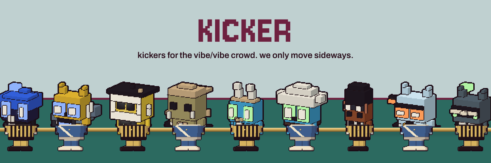
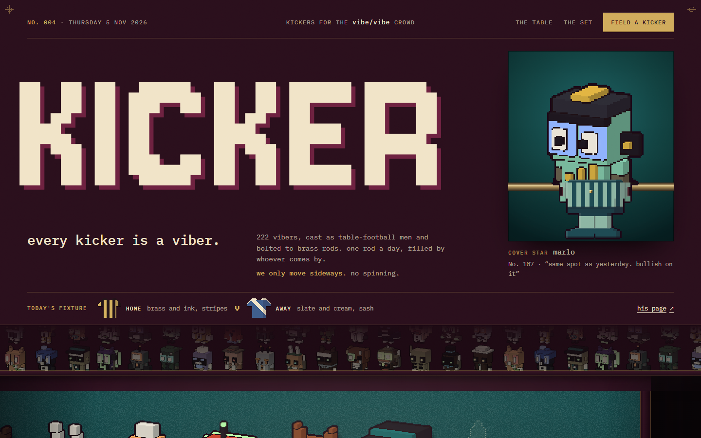
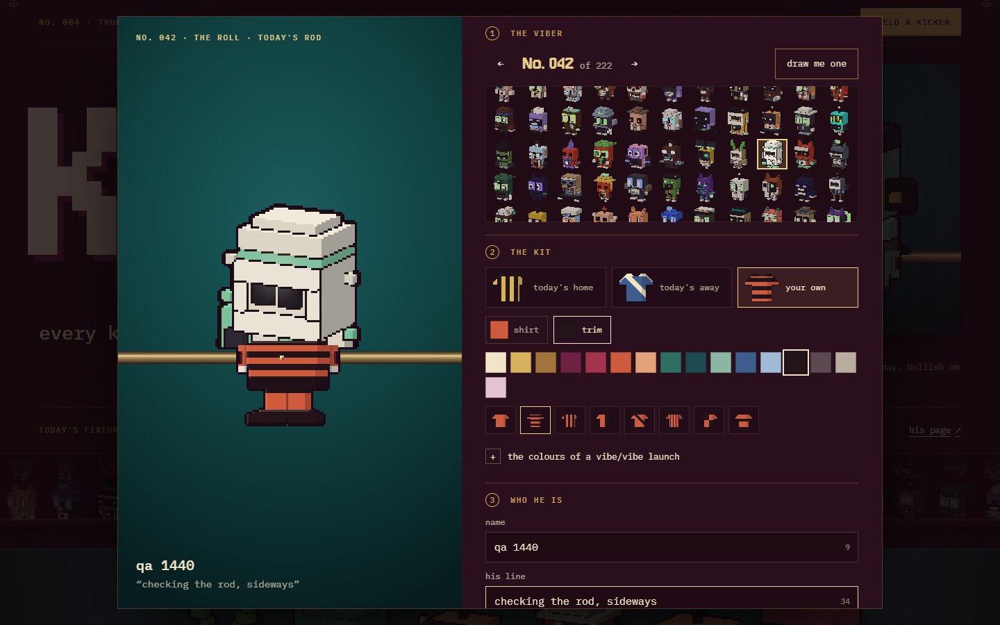
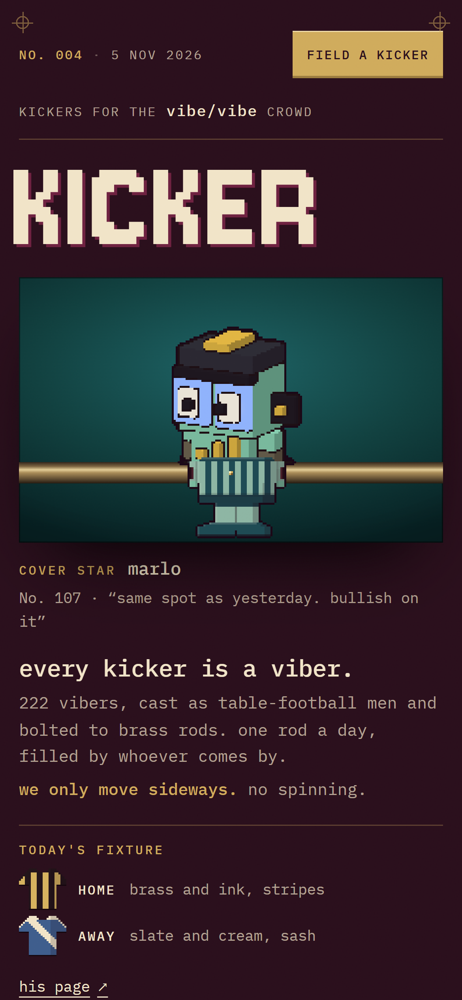
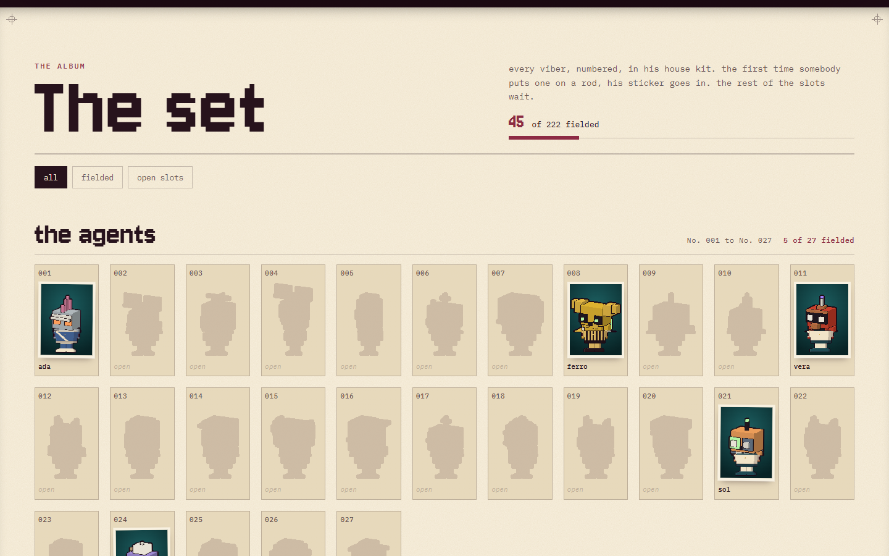
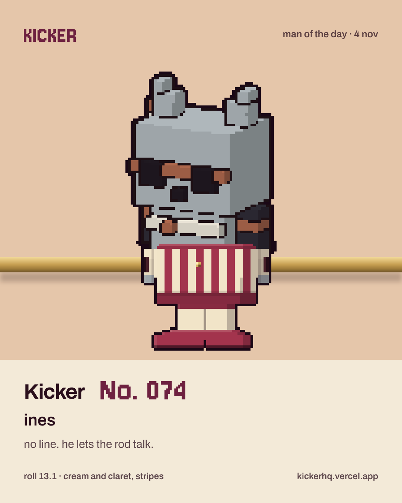
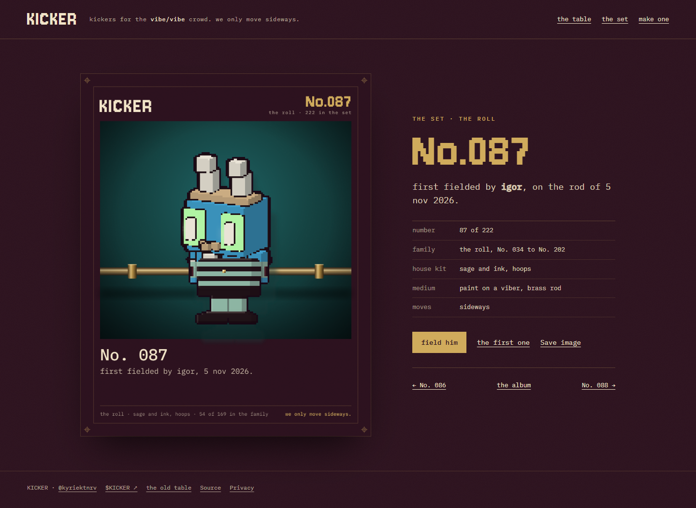
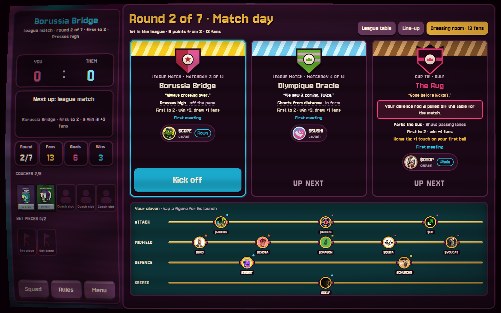
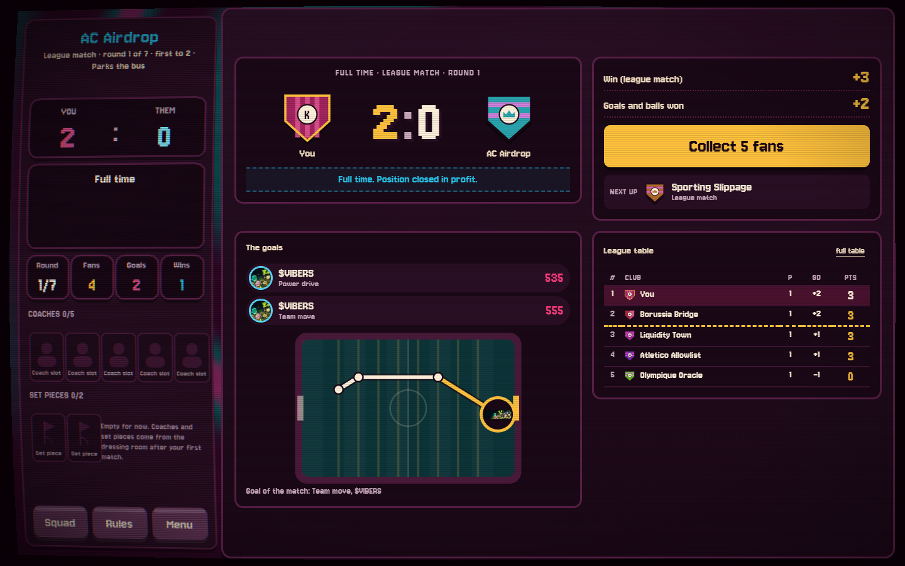
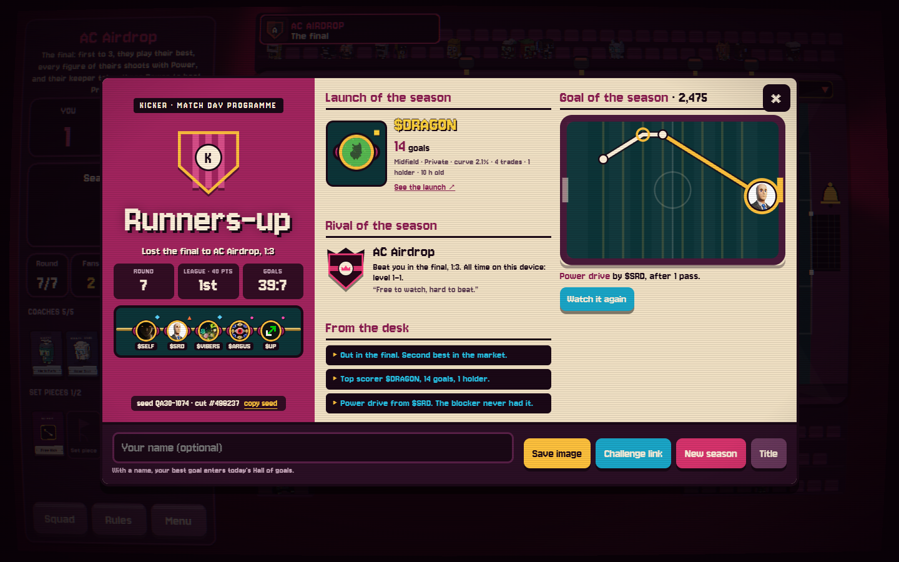

<p align="center">
  
</p>

<h3 align="center">Kickers for the vibe/vibe crowd. Every kicker is a viber. One brass rod a day. We only move sideways.</h3>

<p align="center">
  <a href="https://kickerhq.vercel.app"><b>kickerhq.vercel.app</b></a>
  &nbsp;·&nbsp; <a href="https://testnet.vibevibe.fun/token/0x7e1be1573fD7Fe434a53Abb38356AcfFDF15c1C4">$KICKER on vibe/vibe</a>
  &nbsp;·&nbsp; <a href="https://x.com/kicker_art">@kicker_art on X</a>
</p>

---

## the kickers

Take a viber. Cut him off at the knees, cast him a jersey and a pair of boots in one piece, and put a brass rod through his middle. Now he is a kicker. He can move left and he can move right, and that is the whole of his range, which puts him in the same position as most charts. Spinning the rod is bad form. He does not spin.

There are 222 of them: the set. Every one has a number, No. 001 to No. 222, and a plate at `/k/<number>`.

## the programme

The home page is printed matter. On the cover: the issue number (one a day), today's fixture (the home and away kits of the day) and the cover star, who is the man of the day. Inside: the table. At the back: the album.

<p align="center">
  
</p>

## the table

One long table you walk sideways: wheel, trackpad, drag, the arrow keys, or a swipe. Every day (UTC) gets its own stretch of rod, and whoever comes by that day stands on it. Today is at the right end, by the handles, with an empty place that says "you?". The crowd watches from the stands. Point at a kicker and he kicks; his wall label shows his number, his name and his line.

## field a kicker

Pick a viber from the set, or have one drawn for you. Pick his kit: today's home, today's away, or your own two colours and a pattern (hoops, stripes, halves, sash, pin, quarters, band, plain). A launch from [vibe/vibe](https://testnet.vibevibe.fun) can lend him its colours: paste its token link. Give him a name and one line, put him on the rod, then **Save image** for his plate.

<p align="center">
  
  
</p>

## the album

At the back of the programme, every viber of the set has a numbered slot. The first time somebody fields a viber, his sticker goes in, with the name of whoever fielded him. The rest of the slots wait, printed with a pale outline. The checklist at the end ticks them off. There is no price on anything: the album fills as people play.

<p align="center">
  
</p>

## man of the day

Every day one kicker from yesterday's rod is picked, the same pick for everyone. He is the cover star, and he gets a page at `/m/<id>` (or `/m/today`) with a plate made for X.

<p align="center">
  
  
</p>

## $KICKER

Holders of [$KICKER](https://testnet.vibevibe.fun/token/0x7e1be1573fD7Fe434a53Abb38356AcfFDF15c1C4) stand on a gold stretch of the rod. That is all it does. Signing in is optional, goes through Para, and is never needed to field a kicker.

## manners

No links, no @handles, no tickers, no promo, nothing nasty. Three kickers a day from one place. Kickers who break the manners are taken off the table, and their album slot opens again. What is kept is on [/privacy](https://kickerhq.vercel.app/privacy). KICKER is a fan table for the vibe/vibe crowd, not affiliated with it.

## how it is made

- Vite, TypeScript and Preact. Every kicker is composed from a viber sprite in `public/vibers` by `shared/kicker.ts`: the same pixel arithmetic runs in the browser (canvas) and on the server (sharp and resvg), so a kicker looks the same everywhere. The viber is kept untouched; the jersey, the arms, the boots and the bore for the rod are cast under him.
- The table is one canvas under a native scroller, drawn at whole-number scales. No Pixi on the home page; its first load is about 23 KB gzip of code and styles. The album reads one atlas picture (`public/vibers/set.png`, `npm run kicker:atlas`) when you scroll to it.
- Vercel functions in `api/`, Upstash Redis (`api/_kv.ts`, keys under `side:`). Plates and X pictures are drawn on request with resvg (`api/_sidecard.ts`) and cached; nothing is uploaded.
- `npm test` runs the old games' tests, the table's (`scripts/side-test.ts`) and the kickers' (`scripts/kicker-test.ts`). `npm run kicker:brand` draws the brand pictures from a demo table in memory; `SIDE_SEED=1 npx vite` seeds that demo table on a dev server only; `npm run kicker:qa` screenshots it.

## the old tables

The 4.x club game, a manager game with live launches on the rods, lives at [`/club`](https://kickerhq.vercel.app/club). Club keys keep working.

## The old table (3.0)

The turn-based season game stays at [`/classic.html`](https://kickerhq.vercel.app/classic.html). Everything below describes it; old links, posted seasons and challenge links keep working.

## What it is

Kicker is what the Germans call table football. KICKER is a turn-based table football season played from above: four rods a side, a ball, touches instead of a clock, and a rival club that reacts to every one of them.

Your eleven figures are launches from [vibe/vibe](https://testnet.vibevibe.fun), the token launchpad on Robinhood Chain testnet. Each figure wears its token's picture as a head and its ticker underneath, and its numbers decide how it plays.

<p align="center">
  
  
</p>

## How a match plays

- **The table.** Keeper (1 figure), defence (2), midfield (5) and attack (3), interleaved like a real table. Ten lanes across; the goal mouth is the middle two. A rod slides one lane at a time and its figures move together.
- **Your ball.** Four touches a possession. A touch is a **slide** of one rod (drag the rod, or press a button at its handle), or a **kick** with the figure on the ball: a pass to a figure further up, or a shot. The ball runs straight or one lane sideways per rod it crosses, and comes back off the side walls. Any of their figures in its lane blocks it and wins the ball.
- **They react.** After every touch the rival slides to cover your most dangerous lane, and sets its defence before your first touch. It gets sharper by the round: it shoots with Power, slides twice a touch, looks a slide ahead and half-reads your blocks, then reads them fully. Their own Power launches (past 10% of the curve) shoot through one more blocker.
- **Club styles.** Every club keeps one way of playing: **Parks the bus** (an extra slide at the back once your ball reaches your attack, shoots only from midfield up), **Presses high** (shuts passing lanes from the first whistle, an extra setup slide), **Shoots from distance** (covers shots first; from round 3 its shots from deep go through one blocker).
- **Their ball.** They show the lanes they can kick down (red for shots, amber for passes). You get two block slides a possession; slide into the lanes, then press **Ready**. You are only asked when something threatens: until then their touches play on by themselves.
- **Tight lanes.** A shot into a lane beside their keeper shows an amber disc, not a gold one: the keeper reaches it as one more blocker, so it costs a point of Power. A one-touch shot straight off a pass, or a shot off a side wall, beats the reach for free.
- **Build-up.** Passes in one possession light their lanes on the felt. Two passes put +1 Power on the next shot, and a goal off two passes or more is a Team move.
- **Kickoffs and table events.** Every match opens from one of its club's own kickoff shapes, picked by the seed. Every league match has one table event, named at kickoff and marked on the felt: **Volatile** (off a wall the ball comes back two lanes for every one), **Thin book** (one lane is sticky through midfield), **Green candle** (+1 touch on your first ball), **Halt on the half** (no long passes on either side's first possession).
- **Read the tape.** Hover a slide button (hold it on a phone) and their rods show as ghosts where they will be after they react.
- **Full time.** First to 2 goals (the final: 3), six possessions each, a few more in a cup tie. A league match can end level; a cup tie has to be won.

Nothing is rolled at play time. The squad, the rival clubs and the shelf come from the seed; every move the rival makes comes from the position on the table.

<p align="center">
  
  
</p>

## Haunted table (through 6 Nov 2026)

A three-match event mode for the spooky week on Robinhood Chain testnet. KICKER is an independent project; the mode is our own.

- **Ghost clubs.** Two ghost clubs and The Haunted XI, built from the cut's quietest launches: the ones with no trades in the last 24h (each cut keeps up to 16 aside), then the quietest on the transfer list. Each ghost's tag gives its 24h trade count.
- **Phasing.** One of their rods is a ghost: it blocks only on every other touch of yours. Its handle reads SOLID or FADED.
- **Poltergeist.** After each kick of yours one of their rods drifts a lane on its own. The arrow at its handle shows which rod and which way, a touch before.
- **Graveyard shift.** The lights are low and the ball carries a lantern. Kick lines and threat lines stay lit.
- **Haunted board** in the Hall of goals, and a cosmetic **Haunted kit** mark for winning a Haunted match while the event runs.
- After 6 Nov 23:59 UTC the title shows "Haunted table: closed" and the mode stays playable. `?haunt=preview` forces the event on.

## How a launch becomes a figure

| Stat | Comes from | What it does |
|---|---|---|
| **Power** | curve progress, 10% or more | an attacker's shot goes through one blocker |
| **Pace** | 10+ trades in the last 24h | a free slide for that figure's rod, every possession; a pass to it gets no reaction, so it shoots **first time**, before they move (and skips the Mempool Jam queue) |
| **Grip** | 6+ holders | when its pass is blocked, it keeps the ball, once a possession; on their ball, in your defence or midfield, it is a **wide body** that covers its lane and the next toward the middle, and a Grip keeper reaches both sides; a Grip block that wins the ball back starts your possession with +1 touch |
| **Pair** | what the launch is quoted in: Ether, a stock, VIBEVIBE, or a private token or dollar | a stripe on the shoulders; some coaches read it |
| **Head** | the token's own picture | |

Your squad is drawn by the seed from today's cut and placed by its numbers: the three furthest along their curve up front, the most-held in goal and at the back. Swap anyone in the **Line-up** before a match. The other side of the table is made of launches too: the rival's eleven come from the same cut, with their own pictures.

Hover a figure (or hold it on a phone) for its data tag: holders, 24h trades, age at the cut, price direction, curve progress, gift list, and which number or coach gives it each stat. Keep holding for its page on vibe/vibe.

<p align="center">
  
</p>

## The season

Seven rounds. Each round is two **league matches** and a **cup tie** against a boss club: 21 matches.

- **The league** has eight clubs, you and seven others, and you meet each of them twice (14 matchdays, three points a win, one a draw). Each club has a form, in form, mid-table or off the pace, that sets how sharp it plays you and how its other results go. The table shows after every match and from match day.
- **A league loss does not end the season. The table does**: once two clubs are out of your reach, or if you finish below second.
- **A cup tie has to be won**: a draw or a loss ends the season. In the top two when a cup tie comes round, it is a **home tie**: +1 touch on your first ball.
- **The final.** After the last league matchday the top two meet in the final, played under the **Closing Bell**'s rule. Top of the league gets the extra touch.

Nine boss clubs and the final change one rule each, and the rule shows on the table:

- **The Rug**: your defence rod is pulled off the table.
- **Trading Halt**: your defence or midfield is frozen until the first goal of the match.
- **Vibe Check**: only figures with Power, Pace or Grip may shoot.
- **The Depeg**: your shots drift one lane as they travel.
- **Gas Spike**: each slide costs two touches.
- **Mempool Jam**: passes land a turn late; they react before the ball arrives.
- **Max Slippage**: one touch fewer every possession.
- **Lockup**: your keeper is locked.
- **Wash Trade**: the rod facing yours copies every slide you make.
- **Closing Bell**, the final: first to 3, the rival at full strength, every figure of theirs shoots with Power, and their keeper takes three Power to beat.

## Match day

Between matches the game is a match day, not a menu:

- **Fixture tiles** with each club's kit, crest and chant ("Real Mempool: pending since 2024."), their captain (a real launch from the cut, picked by how the club plays), and your record against them, kept on this device ("You lead 3–1").
- **Full time** is a match report: the score with both crests, a line from the desk, your scorers with their launch heads, the goal of the match drawn on the felt, the fans counted in, the next fixture and the league table.
- **The dressing room** is a locker wall: coaches stand in their lockers on Academy, First team or Club legend name plates, training kit and set pieces hang beside them, and every description is printed on the door.
- **Boss clubs** walk out for the cup ties: the crest slams down, the rule gets its own banner, and their captain steps forward.
- **The programme.** When a season ends you get a match-day programme: a cover in your kit, the launch of the season, the goal of the season drawn on a mini felt, the rival of the season and three lines from the desk. One Save image, a challenge link, a new season or the title.

<p align="center">
  
  
</p>
<p align="center">
  
  
</p>
<p align="center">
  
</p>

## The dressing room

Wins and goals bring **fans**: 3 for a league win, 4 for a cup tie, 1 for a league draw, plus one a goal. Fans are only good for the dressing room, and every price is printed. The shelf is fixed by your seed.

- **Coaches** (31, five seats). Passive tactics, most of them reading the launches on your rods: ETH Maxi gives your Ether-paired figures Power, Dip Buyer gives Grip to figures whose price is down, Early Bird gives Pace to launches under six hours old, Moonboy lowers the Power bar, Valedictorian makes your launch furthest along its curve shoot through two blockers. Hover one to light the figures it works on.
- **Training**. Finishing, Passing, Footwork and Marking, levelled for the season.
- **Set pieces**. One use each: Free Kick, One-Two, Dummy Run, Long Ball, Park the Bus, Season Tickets.

## Goals, the Hall and challenges

Every goal is rated: more for each pass in the move, for an angle, off a wall, for each blocker beaten with Power, from distance and with touches to spare, and more in later rounds and against a boss. A season's best goal is its score.

A season is fixed by its **seed and cut number**. Share the seed and a friend plays the same squad against the same clubs. When a season ends, KICKER makes a **challenge link**: the server plays every touch again, checks it, and draws an image for X of the figures behind your best goal, with the move itself under them: a gold line on the felt, a ring where it came off a wall, the scorer waiting in the net. The move is recomputed from the trail the server already replays, so nothing new is stored. A forged, reordered or unfinished trail is refused.

Verified seasons with a name go into the **Hall of goals**: the day's top 50 best goals (UTC), each with its move on a mini felt (read from the posted season once the row scrolls into view). Haunted table runs have their own board. A seed link opens the title with the seed and a Play button; nothing starts by itself, and a reload always lands on the title with Continue.

<p align="center">
  
</p>

## Daily match day

One seed a day, the same for everybody, on the first cut after 00:00 UTC: one match day of three fixtures under the 3.0 rules, a friendly, a league match and a boss club, about five minutes. A draw goes through in the first two; the boss club has to be beaten. Post it with a name and it lands on the **Daily board** (not the Hall of goals): one line per name, your best of the day counts. Finish it on consecutive days and your device keeps a streak.

## Sign in

Optional. Sign in with email, Google, X, Discord or a wallet, through [Para](https://getpara.com). Browser wallets are offered inside Para's modal; KICKER's own code never calls a wallet, so there is no `window.ethereum` and no EIP-6963 on the page. If you have no wallet, Para makes one for you. It starts with no `$KICKER`.

Para is a lazily loaded React island: it is fetched only when you open sign-in, or hover, focus or touch the button. The rest of the page is Preact and doesn't carry it.

Once a day you sign one plain text message (no gas, no transaction, nothing moves). It claims your Hall of goals name (a ✓ next to it, and nobody else posts under it), keeps **Your table** (Daily streak, best goal of each day, last 30 seasons) on any device, and checks `$KICKER` for team kits.

**Privacy.** Para runs the sign-in and holds your login, plus the wallet it creates for you. KICKER stores no emails or passwords. If you never sign in, your seasons and settings stay in this browser, and the one thing sent anywhere is a season you choose to post, under the name you give it. Signed in, KICKER also keeps the name you claimed, your address and the seasons you post. KICKER has no use for your seed phrase, a private key or funds, and will not ask.

## Team kits

Hold any `$KICKER` on Robinhood Chain testnet and your side can change shirts: **Closing Bell**, **Ticker Tape** and **Pink Sheets**, each with its own felt, and a small house mark next to your name in the Hall of goals and on share images. The server reads your `balanceOf` once with the day's sign-in. Without it nothing is missing: every match plays the same.

## The token

[`$KICKER`](https://testnet.vibevibe.fun/token/0x7e1be1573fD7Fe434a53Abb38356AcfFDF15c1C4) is the game's own launch on vibe/vibe, on Robinhood Chain testnet: a test token with no real value. It is **cosmetic only**. It never changes a figure, a rival or a result. The engine doesn't know the token exists.

## Under the hood

- **Client:** PixiJS v8 (WebGL), TypeScript, Vite, Preact overlays, custom shaders for the swirling background and the CRT pass, WebAudio-synthesised sound, a table that stands upright on phones, `prefers-reduced-motion` respected.
- **Engine:** one pure state machine in `shared/`, run by the page and by the server. The rival is a deterministic evaluator: it scores your threats lane by lane and slides to cover the worst. `shared/bot.ts` is a two-touch-deep player used for balance runs, tests and the "What now?" button.
- **Sign-in:** Para (`@getpara/react-sdk`) in a lazily loaded React island, with its own wagmi connectors for browser wallets. The chain is Robinhood Chain testnet (46630), defined with viem `defineChain`.
- **Server:** Vercel Functions for the squad cut every few hours (farm bots and dead tokens filtered), the daily pin and board, token pictures, season verification, sign-in (viem signature checks, ERC-1271 for smart accounts, name claims, Your table), team kits (one `balanceOf` read), and challenge images (satori + resvg). Responses sit behind the CDN, and nothing polls.
- **Data:** the public vibe/vibe v6 index on Robinhood Chain testnet (chain id 46630).

```bash
npm install
npm run dev     # local dev server
npm run build   # type-check client and api, then build
npm test        # engine, rival, boss clubs, Haunted table, replay guard with the mode, HUD model, daily pin and board, team kits, sign-in, names (in memory)
npm test -- --anvil   # also checks a real ERC-1271 account on a local anvil (port 8520)
npx tsx scripts/sim.ts 300   # the bot plays 300 seasons and reports how far it gets
npx tsx scripts/sim.ts 300 --haunt   # 300 Haunted table runs
```

Sign-in needs a Para API key at build time: `VITE_PARA_API_KEY`, and `VITE_PARA_ENV=PRODUCTION` for a production key (Para's test environment otherwise). Without a key the sign-in button says it is unavailable, and everything else plays the same.

## Notes

News and updates: [@kicker_art on X](https://x.com/kicker_art).

Testnet only. Fans, goals and ratings are a game: they are not money and don't stand for anything you own. KICKER is an independent project built on public vibe/vibe data, and it is not made by the vibe/vibe team.

## License

MIT
